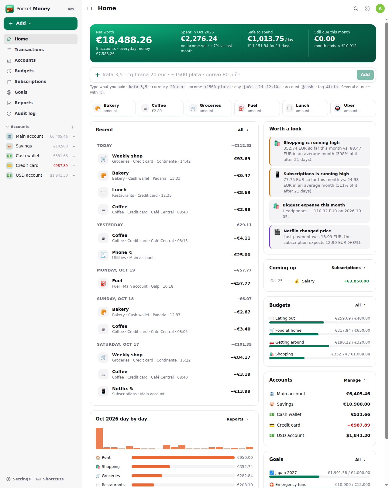
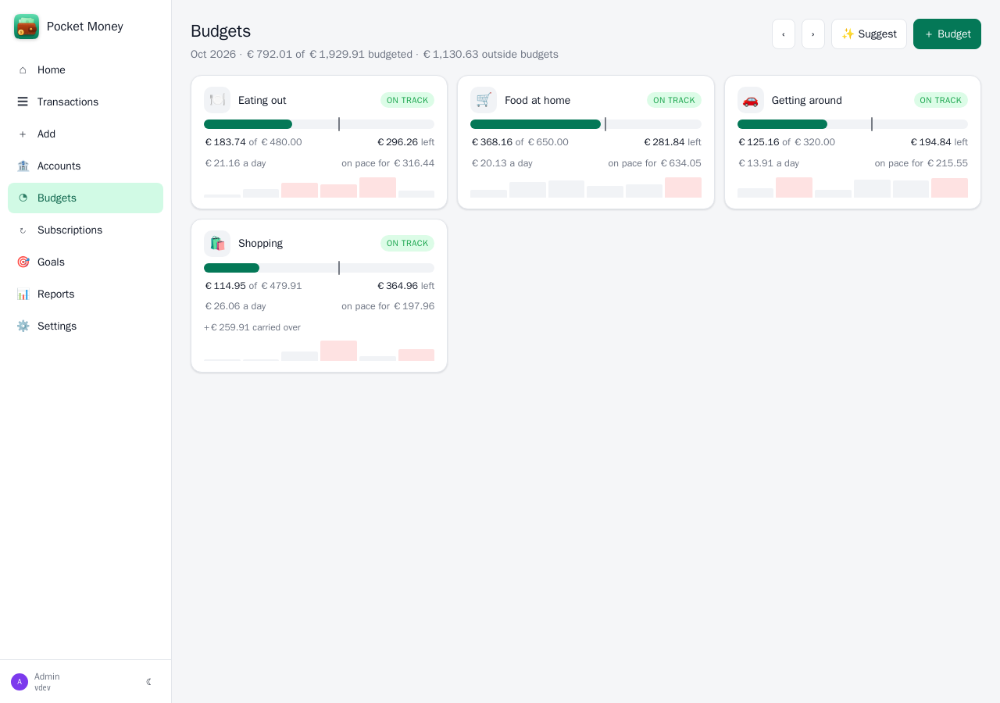
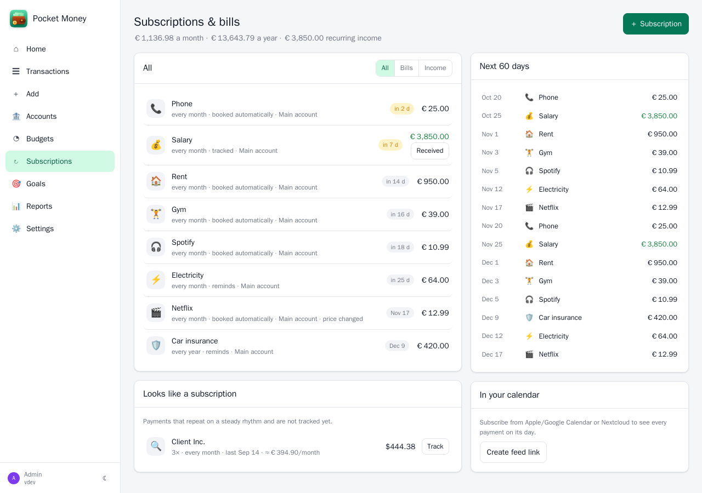
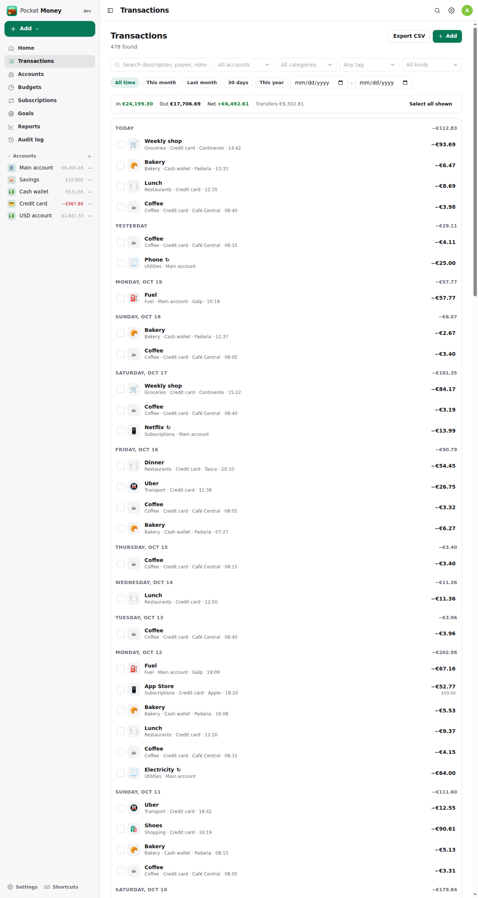
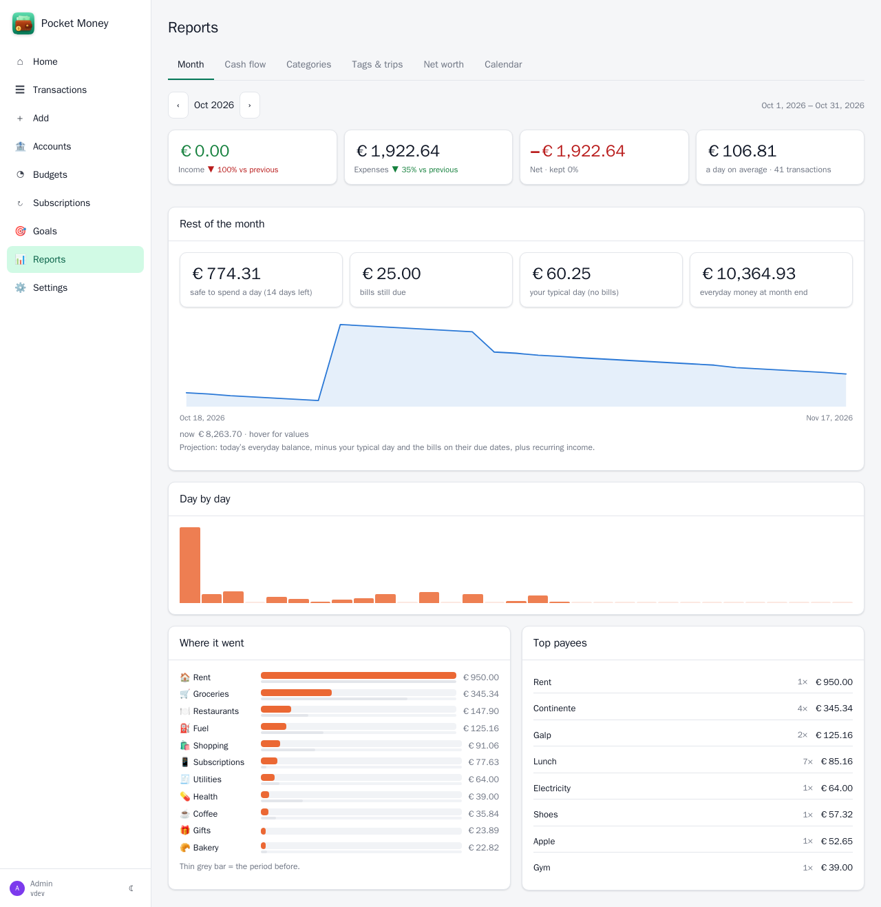
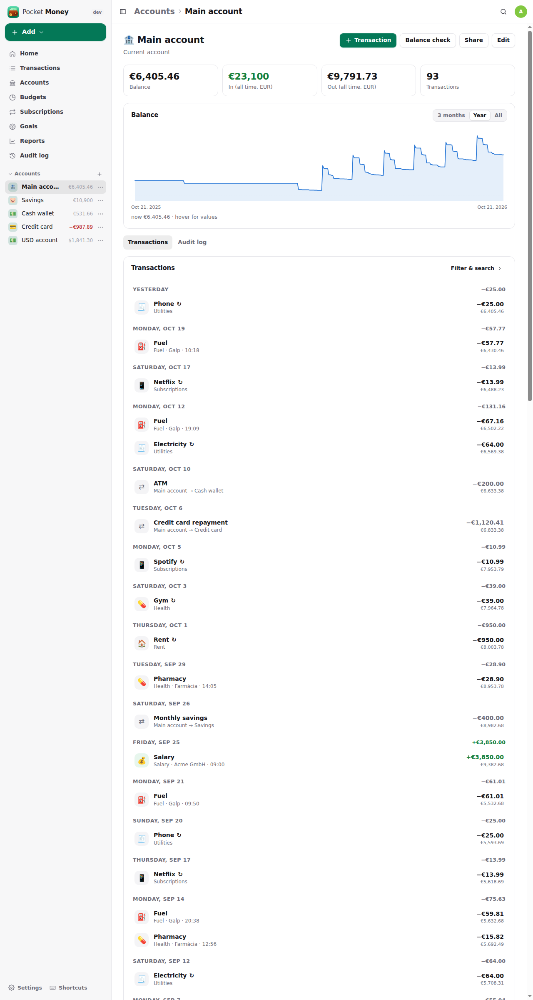
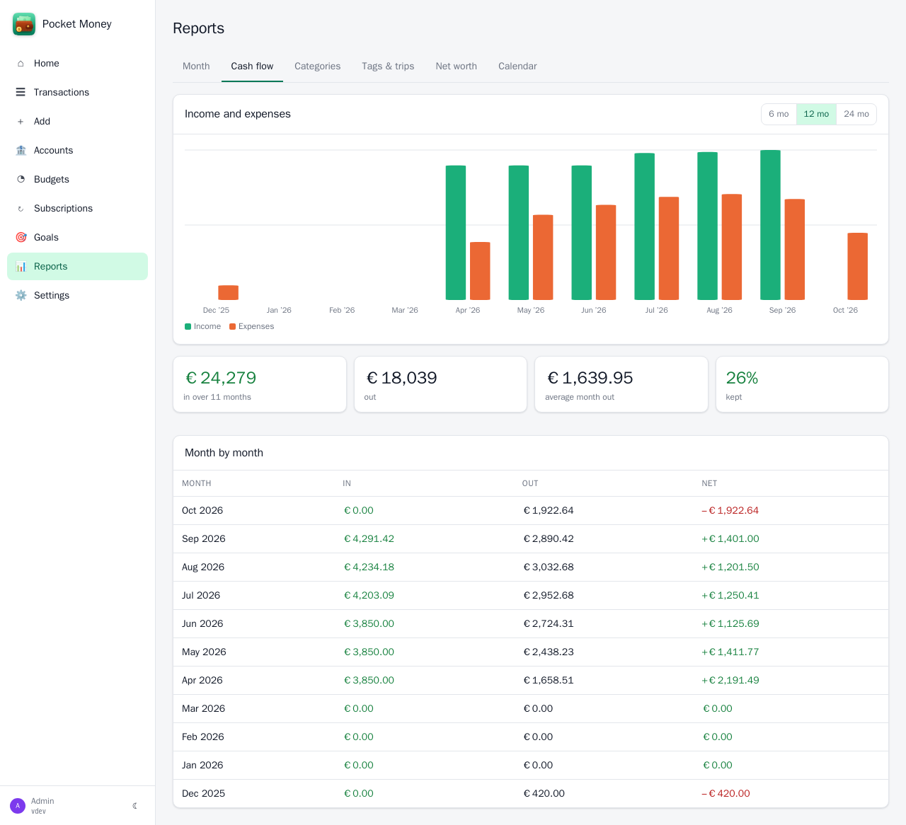
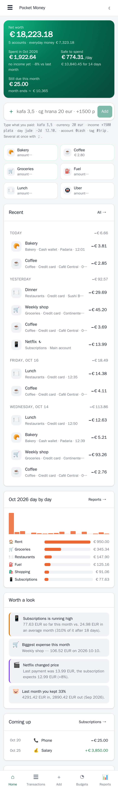
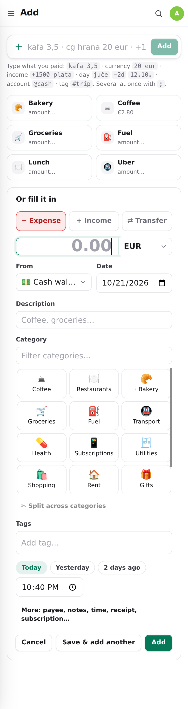

<p align="center">
  
</p>
<h1 align="center">Pocket Money</h1>
<p align="center">
  Personal finance for a homelab — accounts in any currency, quick entry that understands how you talk, subscriptions that remind you or book themselves, budgets with a pace line, savings goals, a forecast of what is safe to spend, and reports — as a small self-hosted server.<br>
  <b>One binary · one SQLite file · one volume.</b>
</p>
<p align="center">
  <a href="https://github.com/abjelosevic88/pocket-homelab-money/actions"></a>
  <a href="https://github.com/abjelosevic88/pocket-homelab-money/pkgs/container/pocket-homelab-money"></a>
  <a href="LICENSE"></a>
</p>

---

I ran Firefly III with Firefly Pico in front of it for quick entry on the phone. Two apps, two databases, a patched JavaScript bundle to make the assistant understand “20 eur”, a cron script for bill reminders, another one to put subscriptions on the dashboard — and still no view of the bills in the app I actually used. Pocket Money is the two of them in one, plus the parts I kept wishing for:

- **Quick entry that understands you.** Type `kafa 3,5`, `cg hrana 20 eur`, `+1500 plata`, `gorivo 80 juče`, `taxi 12 usd @cash #lisbon` — amounts with a comma or a dot, currencies by code, symbol or word (`maraka`, `eura`, `dolara`), days in English or Bosnian/Croatian/Serbian, an account with `@`, a transfer with `>`, tags with `#`. Several at once with `;`. A preview shows what will be booked before you press Enter. No AI involved.
- **Templates you tap.** One tap books “Coffee 2.80”; templates without an amount open the form. They also work as prefixes in quick entry (`cg h 20` → “cg hrana”), and the most used ones come first on every device.
- **It learns your categories.** A description you used before gets the category it usually had — in quick entry, the form and imports. Rules (contains / regex / amount between…) cover the rest and can be run over old transactions.
- **Any currency, honestly.** Each account has one currency; pay 20 EUR from a BAM account and the receipt amount is kept while the account is charged at that day's rate — or at your bank's, if you type it. Every transaction stores its value in your home currency, so reports never re-guess rates. Euro pegs (BAM, BGN, XOF…) are exact and give dated cross rates.
- **Subscriptions and bills in one place.** Rent, phone, streaming, salary: every N days/weeks/months/years, on a day of the month or “the last Friday”, a fixed or varying amount, moved off weekends (or skipped), and ending after N payments if it is a loan or a plan. Per item: remind me N days ahead, book it automatically on the day, or just track it. Payments you enter are **linked automatically** (name, amount, around the due date), price changes are flagged, and Pocket Money **spots repeating payments you never set up**. A calendar feed puts every payment on its day.
- **Budgets with a pace line.** Per week, month or year, over categories (children included) and/or tags, with optional rollover. Each card shows what is left, what you can spend per day, where you will end at this pace and a marker for how much of the month is gone. “Suggest” proposes budgets from the last three months.
- **Safe to spend.** Everyday money plus pay still coming, minus bills still due this month and what your goals ask you to put aside — per day. A 30-day projection of your balance with every bill on its date.
- **Goals.** A trip, a laptop, an emergency fund — as deposits or as the balance of a savings account; the monthly amount needed to make the date, whether you are on track, and when you will get there at this pace.
- **Payday months.** Let a “month” run from the 25th to the 24th, and budgets, reports and the forecast follow.
- **Reports that answer something.** Month overview against the month before, cash flow, categories against their 3-month average, spending per tag (a trip, a car), net worth over time with every account valued at that day's rate, a spending calendar, plain-language insights (“Restaurants is running high”, “Netflix changed price”, “Last month you kept 34 %”), and — with an API key — **Ask your money** in any language.
- **Voice and free text (optional).** With an OpenAI-compatible key: dictate “juče 20 maraka pekara i 35 eura gorivo sa unicredit” and get two drafts to confirm.
- **Brings Firefly over, and keeps its API.** A one-time import of Firefly III and Firefly Pico — accounts with their exact balances, categories (with an emoji picked from the name), tags, every transaction with foreign amounts and notes, bills and recurring transactions merged into subscriptions, piggy banks, Pico templates with their currency. Re-runnable and keyed by Firefly ids; can keep mirroring while both run. And a **Firefly III-compatible API** at `/firefly/api/v1`, so Raycast, phone apps, scripts and other apps that read Firefly only change their URL.
- **Split receipts.** One supermarket bill, three categories: split it into parts with their own category and note, and reports, budgets and filters count each part where it belongs. Firefly clients see and create them as split groups.
- **Loans, mortgages and IOUs.** Who owes whom, the interest rate, the monthly payment: see what is left, how much is repaid, when it will be paid off and how much interest that costs, with a month-by-month schedule. Interest can be booked automatically on the payment day.
- **Running balance.** On an account the list shows the balance after every transaction, so a statement can be checked line by line.
- **Webhooks.** Added, changed and deleted transactions, budget alerts and due bills are POSTed to any URL and signed with HMAC. Pocket Day uses this to show a booking within seconds. A Firefly III-format option keeps receivers written for Firefly working.
- **Bank statements.** CSV import with column mapping, debit/credit columns, any date and decimal format, a dry run, and duplicate detection so overlapping statements are fine.
- **Sign in with PocketID (or any OIDC provider).** Passkeys instead of a password, passwords can be switched off, and API tokens keep working for apps and scripts.
- **One ledger per person.** Everyone in the household signs in to their own books: accounts, transactions, categories, tags, budgets, goals, subscriptions, templates, rules, webhooks, reminders, AI and integration settings, API tokens and the Firefly mirror are each person's alone — admins included see nothing of anyone else's. Share an account (see or book) for the joint money; that shares its transactions and nothing more, and everyone booking on it uses the owner's categories, so a household account keeps one list. The Firefly-compatible API answers with the token owner's books.
- **Everything else.** Receipts (camera on the phone), shared accounts (see or book), transfers between currencies, balance checks that book the difference, bulk edit, CSV/JSON export, payment reminders and budget alerts through Apprise/ntfy/webhook, a weekly digest, a Homepage widget endpoint, a PWA with an Add shortcut.

<p align="center"></p>

<table>
  <tr>
    <td width="50%"></td>
    <td width="50%"></td>
  </tr>
  <tr>
    <td align="center"><sub>Budgets: what is left, per day, at this pace — the line is today.</sub></td>
    <td align="center"><sub>Subscriptions: remind, book automatically or track; repeating payments found for you.</sub></td>
  </tr>
  <tr>
    <td width="50%"></td>
    <td width="50%"></td>
  </tr>
  <tr>
    <td align="center"><sub>Transactions: search, filter, totals, bulk category and tags, CSV.</sub></td>
    <td align="center"><sub>Reports: the month, the rest of the month, where it went.</sub></td>
  </tr>
  <tr>
    <td width="50%"></td>
    <td width="50%"></td>
  </tr>
  <tr>
    <td align="center"><sub>Accounts: balance over time, balance check, sharing.</sub></td>
    <td align="center"><sub>Cash flow per month.</sub></td>
  </tr>
</table>

<p align="center">
  &nbsp;&nbsp;<br>
  <sub>On the phone: the same app, installable as a PWA with an “Add” shortcut.</sub>
</p>

## Run it

```bash
mkdir pocket-money && cd pocket-money
curl -fsSLO https://raw.githubusercontent.com/abjelosevic88/pocket-homelab-money/main/docker-compose.yml
docker compose up -d
# open http://localhost:8080 and create your account
```

Or with plain Docker:

```bash
docker run -d --name pocket-money -p 8080:8080 -v $PWD/data:/data ghcr.io/abjelosevic88/pocket-homelab-money:latest
```

Or the binary from the [releases](https://github.com/abjelosevic88/pocket-homelab-money/releases) (Linux, macOS, Windows, FreeBSD): `DATA_DIR=./data ./pocket-money`. A systemd unit is in `deploy/systemd/`.

### Coming from Firefly III (and Firefly Pico)

1. Set `FIREFLY_URL`, `FIREFLY_TOKEN` (a personal access token) and optionally `PICO_URL` before the first start — everything comes over while the database is still empty. Or later under **Settings → Import**; it is re-runnable and never duplicates.
2. While you still enter things in Firefly, tick **Keep mirroring**: new and changed Firefly transactions come over every 30 minutes, and Pocket Money's own automatic bookings wait so nothing is booked twice.
3. Point everything that talked to Firefly at `https://<money>/firefly` with a Pocket Money token (Settings → API & apps). Untick mirroring the day you switch.

### Integrations

All optional, under **Settings → Integrations** (or environment variables, see [docs/configuration.md](docs/configuration.md)):

- **Notifications** — an Apprise gateway endpoint, an ntfy topic URL or any JSON webhook; pick the hour.
- **AI** — any OpenAI-compatible key: voice and free-text entry, “Ask your money”.
- **Pocket Travel** — while a trip runs, new expenses get the trip's tag, and the trip's budget in Pocket Travel shows them. Each person picks how Money reaches their Travel under Settings → Integrations: **Pocket Core** (an app link, nothing to paste; the default with Core and no token), **Direct** (their own URL + API token; the default when a token is saved) or **Off**, with a status line saying whether it works and why not.
- **Pocket Core** — with Core on the box the app registers itself, publishes `money.transaction_created`, `money.transaction_deleted` and `money.subscription_paid`, accepts paired-phone tokens, finds Pocket Travel without a `TRAVEL_URL` setting, and shows “Sign in with Pocket Core” on the login page with no OIDC configuration at all. It also **offers app links**: another Pocket app the person allowed in Core (Pocket Garage booking car costs, say) can list their accounts and categories (`accounts:read`), book transactions (`transactions:write`) and read their transactions, tags, accounts and categories (`transactions:read`, natively and on the Firefly-compatible API, which is how Pocket Travel shows trip costs and Pocket Day the day's spending) with a five-minute Core token. Such a token reaches only those routes, read-only for `transactions:read`, and an app may change or delete only the transactions it booked (`source` = its slug). The person's audit log names the app. Money also **uses** a link itself: `trips:read` in Pocket Travel, for the running trip's tag.

## Documentation

- [Configuration](docs/configuration.md) — every environment variable, auth modes, CLI
- [API](docs/api.md) — REST API, quick-entry grammar, the Homepage dashboard, the Firefly III-compatible endpoints
- [Reverse proxy](docs/reverse-proxy.md) — Caddy, Traefik, nginx, forward auth
- [Backup & restore](docs/backup.md)
- [Roadmap](docs/roadmap.md)

## Develop

```bash
make dev      # Go API on :8080 with demo data + Vite on :5173
make test     # go vet, go test, tsc
make          # build web/dist and the binary
make docker   # local image
```

Go 1.26 + chi + modernc SQLite (pure Go, no CGO); React 19 + Vite + TypeScript, no UI framework. The server is in `internal/` (store, server, quick-entry parser, Firefly reader, FX), the UI in `web/src/`.

## Sibling projects

Pocket Money is one of the Pocket Homelab apps — small single-binary servers that talk to each other: [Pocket Habits](https://github.com/abjelosevic88/pocket-homelab-habit-tracker), [Pocket Inventory](https://github.com/abjelosevic88/pocket-homelab-inventory), [Pocket Bookshelf](https://github.com/abjelosevic88/pocket-homelab-bookshelf), [Pocket Split](https://github.com/abjelosevic88/pocket-homelab-cost-split), [Pocket Clips](https://github.com/abjelosevic88/pocket-homelab-clips), [Pocket Travel](https://github.com/abjelosevic88/pocket-homelab-travel), [Pocket Garage](https://github.com/abjelosevic88/pocket-homelab-garage), [Pocket Kitchen](https://github.com/abjelosevic88/pocket-homelab-kitchen), [Pocket Day](https://github.com/abjelosevic88/pocket-homelab-day).

## License

MIT — see [LICENSE](LICENSE).
